# Lab 2: Agile Backlog Creation & Sprint Simulation in Jira

- **Student Reference Number (SRN)**: PES1UG24CS396
- **Name**: SAGAR A WALIKAR
- **Semester & Section**: 5th Semester, Section G
- **Scenario Number**: Problem Statement #28
- **Project Title**: Inter-City Freight Load Matching Marketplace
- **Primary Domain**: Smart Cities, Transport & Logistics
- **Target Actors**: Freight Carrier, Shipper, Platform Escrow Service / Administrator

---

## 1. Objective & Overview

The objective of Lab 2 is to translate the system and functional requirements specified in Lab 1 into an actionable Agile Scrum product backlog in Jira, estimate effort using the Fibonacci sequence, simulate multi-sprint delivery across two sprints, evaluate velocity and execution metrics using Sprint Burndown Charts, and critically analyze the Agile project management lifecycle.

### Deliverables in this Directory:
* `PES1UG24CS396_LAB02.pdf` / `Software Engineering - LAB 2.pdf` — Complete formal Lab 2 submission document with student credentials, backlog tables, sprint progression records, burndown chart analysis, and reflection answers.
* `PES1UG24CS396_LAB02.docx` / `Software Engineering - LAB 2.docx` — Editable Word document version of the laboratory submission.
* `README.md` — Complete markdown documentation with Agile backlog breakdown, sprint simulations, reflection answers, and screenshot references.
* `*.png` — High-resolution captures of Jira Epics, Backlog, Sprint Boards (Planning, To Do, In Progress, Completed), and Burndown Charts.

---

## 2. Epics & User Stories Breakdown

Functional and Non-Functional requirements from Lab 1 are systematically decomposed into **3 Epics** and **9 User Stories** adhering to standard Agile syntax (`As a [role], I want to [action], so that [outcome]`).

### **Epic 1: Load Management & Bidding**
*Description: Enable shippers to create comprehensive freight load listings and allow verified motor carriers to discover auctions and submit competitive bids.*

| Story ID | Work Item Summary | User Story | Priority | Story Points | Sprint |
| :--- | :--- | :--- | :---: | :---: | :---: |
| **SCRUM-8** | Post Freight Load | **As a** Shipper, **I want to** post a new freight load listing with origin, destination, cargo classification, gross weight, pickup window, and reserve price, **so that** qualified trucking carriers can discover and evaluate the shipment. | High | 8 | Sprint 1 |
| **SCRUM-9** | Submit Bid | **As a** Freight Carrier, **I want to** submit competitive bids along with proposed pickup/delivery schedules on active freight load postings before the auction window closes, **so that** I can secure transport contracts. | High | 8 | Sprint 1 |
| **SCRUM-10** | Award Bid | **As a** Shipper, **I want to** review all carrier bids submitted for a freight load and award the contract to the chosen carrier, **so that** the auction concludes cleanly and logistics execution can commence. | Medium | 5 | Sprint 1 |

---

### **Epic 2: Shipment Tracking & Escrow Settlement**
*Description: Provide end-to-end shipment visibility and enforce automated, condition-based escrow payment releases upon verifiable delivery confirmation.*

| Story ID | Work Item Summary | User Story | Priority | Story Points | Sprint |
| :--- | :--- | :--- | :---: | :---: | :---: |
| **SCRUM-13** | Track Shipment Status | **As a** Shipper or Carrier, **I want** real-time visibility into the lifecycle status of a load (Posted $\rightarrow$ Bidding $\rightarrow$ Awarded $\rightarrow$ In-Transit $\rightarrow$ Delivered $\rightarrow$ Paid), **so that** shipment milestones are transparent without manual status follow-ups. | Medium | 5 | Sprint 1 |
| **SCRUM-11** | Upload Proof of Delivery | **As an** Assigned Freight Carrier, **I want to** electronically upload delivery proof (e-signature, geo-tagged photo, or scanned consignment note) upon destination arrival, **so that** shipment completion is verifiably confirmed. | High | 5 | Sprint 2 |
| **SCRUM-12** | Automated Escrow Payment | **As a** Freight Carrier, **I want** freight funds held in platform escrow to release and disburse automatically within 60 seconds of verified delivery sign-off, **so that** payment latency and cash-flow friction are eliminated. | High | 5 | Sprint 2 |

---

### **Epic 3: Quality, Scalability & Compliance Verification**
*Description: Validate non-functional performance benchmarks, concurrent bidding scalability, and regulatory permit verification security standards.*

| Story ID | Work Item Summary | User Story | Priority | Story Points | Sprint |
| :--- | :--- | :--- | :---: | :---: | :---: |
| **SCRUM-18** | Carrier Verification Security Audit | **As a** Platform Compliance Officer, **I want** carrier motor vehicle permits and operating licenses cryptographically validated against transport authorities prior to authorizing bids, **so that** unauthorized operators are prevented from bidding. | Medium | 3 | Sprint 1 |
| **SCRUM-16** | Escrow Payment Performance Testing | **As a** Systems Performance Engineer, **I want to** execute automated stress benchmarking on the escrow disbursement gateway to prove sub-60-second payment processing under peak transactional load, **so that** NFR-001 targets are certified. | High | 4 | Sprint 2 |
| **SCRUM-17** | Bidding System Load Testing | **As an** Infrastructure Architect, **I want to** benchmark auction engine throughput under 500+ concurrent active bidding sessions to ensure submission response times remain strictly under 2 seconds, **so that** NFR-002 scalability standards are maintained. | High | 3 | Sprint 2 |

---

## 3. Backlog Estimation & Story Point Rationale

Story points were estimated using the **Fibonacci scale** (1, 2, 3, 5, 8, 13) via team **Planning Poker** techniques based on complexity, uncertainty, and development effort:
* **8 Story Points (High Complexity & Integration Overhead)**:
  - `SCRUM-8` (Post Freight Load): Involves multi-field geographic route calculations, cargo volume/weight constraint validations, reserve price modeling, and database indexing.
  - `SCRUM-9` (Submit Bid): Requires real-time auction synchronization, deadline validation, dynamic permit verification hooks, and carrier quote ranking.
* **5 Story Points (Substantial Logic & State Transitions)**:
  - `SCRUM-10` (Award Bid): Involves state locking, transactional notification dispatch to losing bidders, and contractual commitment binding.
  - `SCRUM-13` (Track Shipment Status): Requires event-driven WebSocket milestone notifications across carrier and shipper dashboards.
  - `SCRUM-11` (Upload Proof of Delivery): Involves secure file uploads, image compression, metadata geo-tag verification, and tamper-evident storage.
  - `SCRUM-12` (Automated Escrow Payment): Requires payment gateway webhook integration, automated escrow ledger reconciliation, and strict conditional release logic.
* **4 & 3 Story Points (Targeted Verification & Security Audits)**:
  - `SCRUM-16` (Escrow Payment Performance Testing - 4 SP): Automated performance test harness execution with Locust/JMeter measuring disbursement turnaround under synthetic transaction bursts.
  - `SCRUM-17` (Bidding System Load Testing - 3 SP): Concurrent load simulation testing response latencies under 500 active simulated bidding connections.
  - `SCRUM-18` (Carrier Verification Security Audit - 3 SP): Targeted integration audit validating third-party transport registry API responses and expired license rejection filters.

**Total Product Backlog Estimation**: **46 Story Points** (Sprint 1: 29 SP | Sprint 2: 17 SP)

---

## 4. Sprint Simulation Summary

### **Sprint 1: Core Marketplace Bidding & Contract Lifecycle (29 Story Points)**
* **Sprint Goal**: Deliver core load listing, carrier bidding mechanics, contract awarding, live status tracking, and regulatory permit verification.
* **Included User Stories**:
  - `SCRUM-8`: Post Freight Load (8 SP)
  - `SCRUM-9`: Submit Bid (8 SP)
  - `SCRUM-10`: Award Bid (5 SP)
  - `SCRUM-13`: Track Shipment Status (5 SP)
  - `SCRUM-18`: Carrier Verification Security Audit (3 SP)
* **Lifecycle Progression**: All 5 user stories transitioned systematically: `To Do` $\rightarrow$ `In Progress` $\rightarrow$ `Done`.
* **Sprint 1 Outcome**: **29 / 29 Story Points** completed successfully.

### **Sprint 2: Delivery Verification, Escrow Automation & Scalability (17 Story Points)**
* **Sprint Goal**: Implement proof-of-delivery uploads, automated escrow settlement pipelines, and stress-test performance SLAs.
* **Included User Stories**:
  - `SCRUM-11`: Upload Proof of Delivery (5 SP)
  - `SCRUM-12`: Automated Escrow Payment (5 SP)
  - `SCRUM-16`: Escrow Payment Performance Testing (4 SP)
  - `SCRUM-17`: Bidding System Load Testing (3 SP)
* **Lifecycle Progression**: All 4 user stories moved through `To Do` $\rightarrow$ `In Progress` $\rightarrow$ `Done`.
* **Sprint 2 Outcome**: **17 / 17 Story Points** completed successfully, achieving 100% backlog burnup.

---

## 5. Burndown Chart Analysis & Insights

The Jira Sprint Burndown Charts measure remaining effort (Story Points) against the planned linear burn rate over sprint duration:

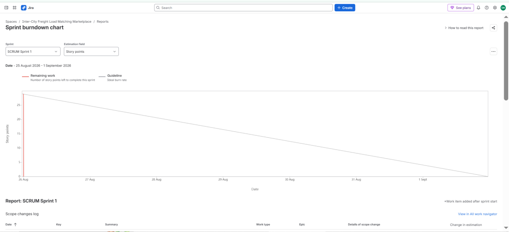
*Figure 1: SCRUM Sprint 1 Burndown Chart (29 Story Points)*

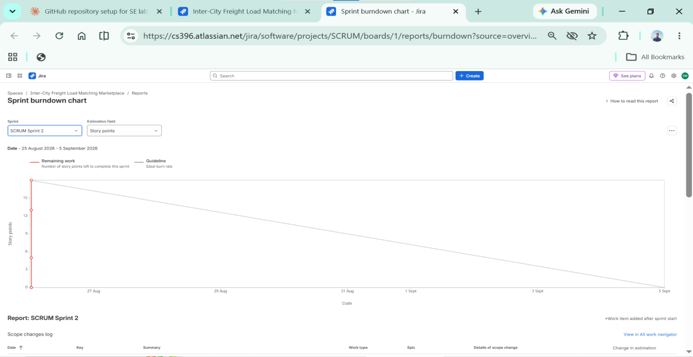
*Figure 2: SCRUM Sprint 2 Burndown Chart (17 Story Points)*

### Key Observations:
* **Initial Sprint Commitment**: Sprint 1 began with **29 story points**, representing the heavy foundational mechanics of freight listing and real-time bidding. Sprint 2 tracked **17 story points**, concentrating on delivery confirmation and compliance stress testing.
* **Burndown Behavior**: Work points burned down in distinct, measurable increments as stories satisfied the Definition of Done (DoD) and cleared code review and integration acceptance tests.
* **Capacity Alignment**: The team demonstrated consistent velocity across both sprints without introducing mid-sprint scope creep or unestimated spillover tasks.

---

## 6. Answers to Reflection Questions

### 1. Did your estimations reflect the actual effort?
> Yes, the story point estimations accurately reflected the relative technical complexity and implementation risk of each feature. Larger stories—such as **Post Freight Load (`SCRUM-8`)** and **Submit Bid (`SCRUM-9`)**—were appropriately estimated at **8 story points** due to their reliance on real-time auction synchronization, multi-attribute cargo validation, and concurrent state management. In contrast, security validation and load-testing tasks (`SCRUM-16`, `SCRUM-17`, `SCRUM-18`) were scoped between **3 and 4 points** because they leveraged existing testing harnesses and external API contracts. In a simulated Scrum cadence, Fibonacci estimation provided an effective framework for capacity allocation without confusing points with raw work hours.

### 2. Was your backlog well-prioritized?
> **Yes.** The backlog prioritization strictly followed functional dependency and business criticality principles. A freight marketplace cannot function without load postings and carrier bidding, making Epic 1 the top priority (**High Priority**, Sprint 1). Tracking status (`SCRUM-13`) and permit verification (`SCRUM-18`) were executed alongside bidding to prevent fraudulent submissions and ensure transparent auction state visibility. Downstream workflows—such as proof-of-delivery upload (`SCRUM-11`) and automated escrow payment disbursement (`SCRUM-12`), along with performance load tests (`SCRUM-16`, `SCRUM-17`)—were scheduled in Sprint 2 because settlement logic inherently depends on having an awarded contract and active transit lifecycle established in Sprint 1.

### 3. How did your simulated sprint align with your plan?
> The simulated sprint aligned closely with the release plan. Sprint 1 absorbed **29 story points** covering the foundational matching engine, and all 5 planned stories completed the lifecycle from `To Do` to `In Progress` and `Done` within the designated timebox. Sprint 2 absorbed the remaining **17 story points**, focusing on transaction settlement and performance benchmarking, concluding with zero rollover debt. The sequential progression simulated real-world Agile ceremonies (backlog grooming, daily standups, and sprint reviews) while confirming that the backlog was scoped within sustainable sprint velocity boundaries.

### 4. What insights did the burndown chart give about your team's capacity?
> The burndown chart provided critical operational insights into delivery rhythm, completion velocity, and workload distribution. In Sprint 1, the burndown tracked the planned guideline closely as stories completed in staggered increments, demonstrating that tasks were decoupled and not held up by single-point bottlenecks. In Sprint 2, the rapid closure of testing and verification tasks reflected high execution efficiency once the core architecture was operational. For an engineering team, consistent downward burndown confirms realistic sprint capacity planning, whereas early flatlines would signal blocked dependencies or underspecified requirements requiring backlog refinement.

---

## 7. Jira Artifacts & Screenshots

| Phase / Step | Artifact Screenshot Preview |
| :--- | :--- |
| **Epics Overview & Configuration** |  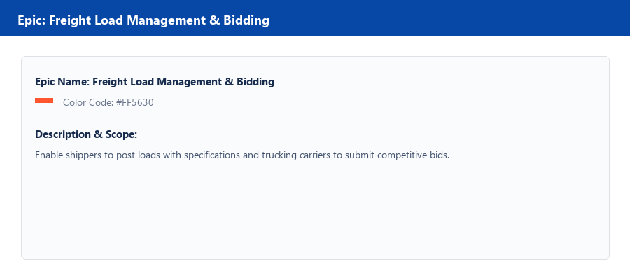 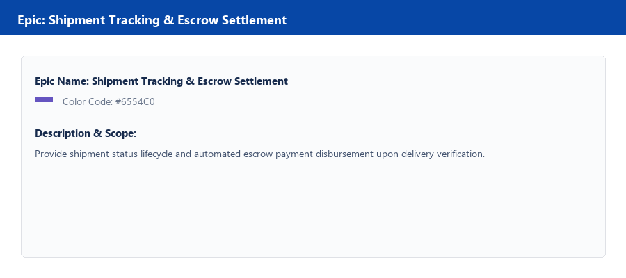 |
| **Complete Backlog in Jira** |  |
| **Prioritized Backlog** | 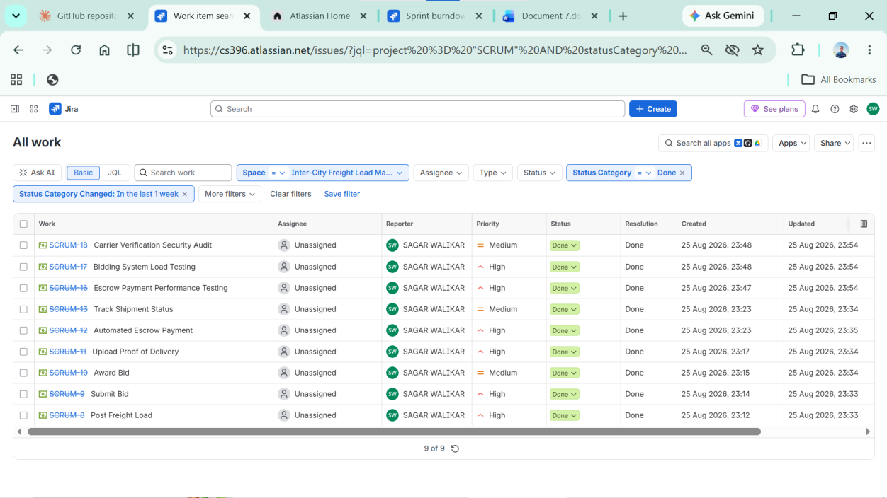 |
| **Story Points Assigned** | 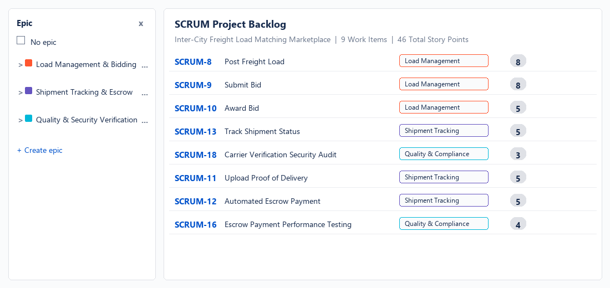 |
| **Sprint 1 Planning** | 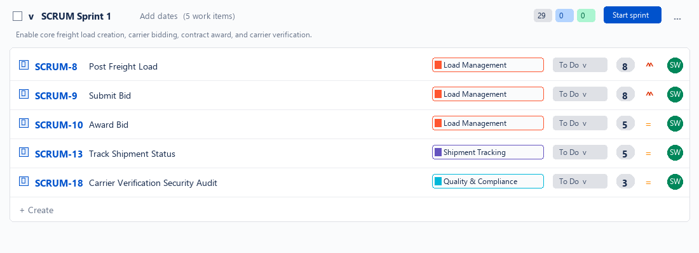 |
| **Sprint 1 Active Board (To Do)** | 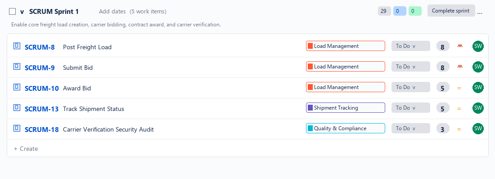 |
| **Sprint 1 Active Board (In Progress)** | 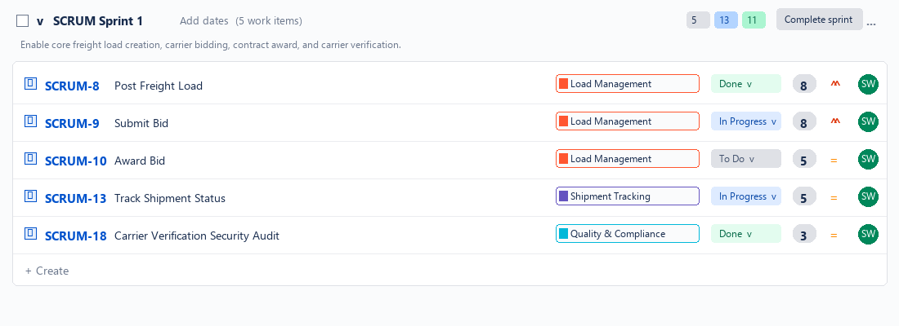 |
| **Sprint 1 Completed Board** | 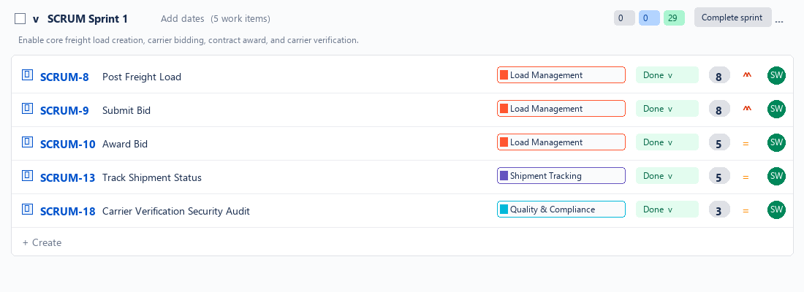 |
| **Sprint 2 Planning** | 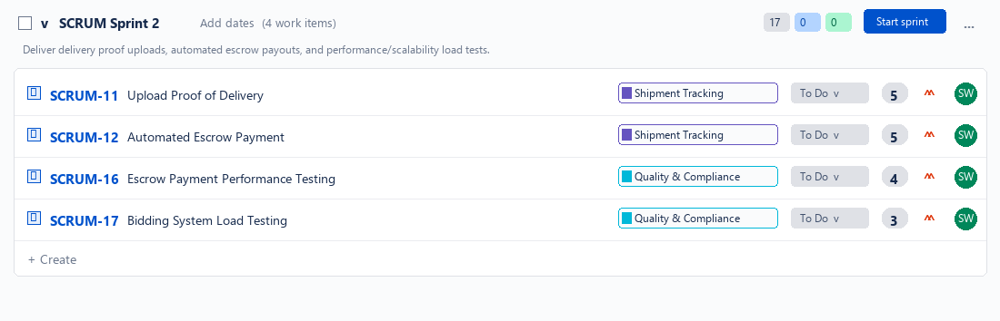 |
| **Sprint 2 Active Board (To Do)** | 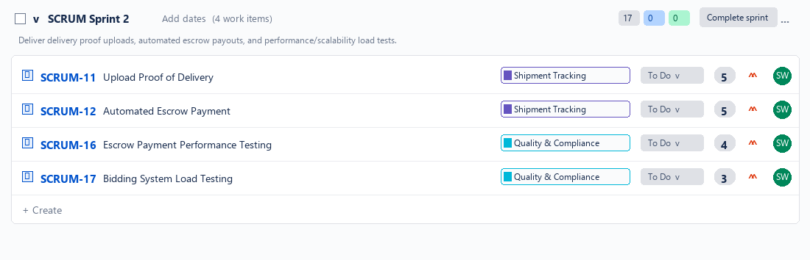 |
| **Sprint 2 Active Board (In Progress)** | 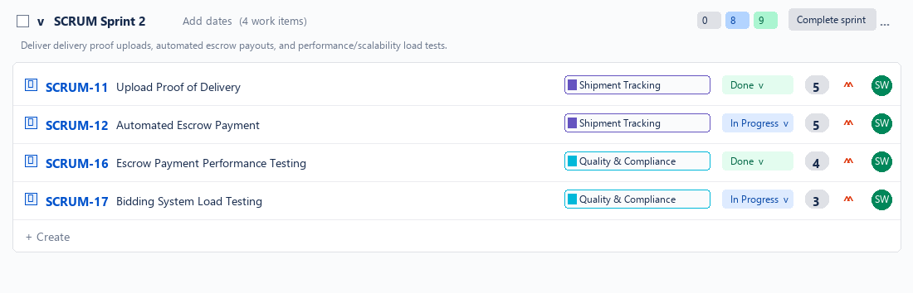 |
| **Sprint 2 Completed Board** | 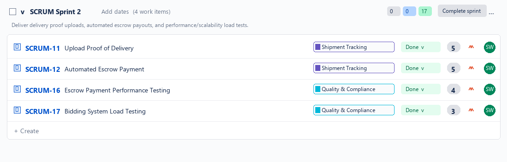 |
| **Sprint 1 Burndown Chart** |  |
| **Sprint 2 Burndown Chart** |  |
